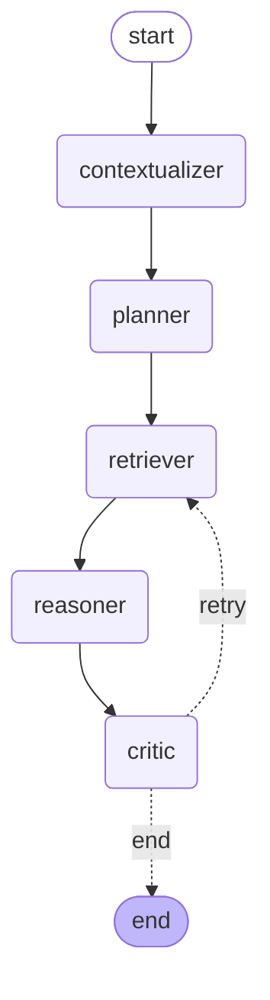

# SmartPaper AI

> Upload a research paper. Ask questions in plain language. Get answers grounded in the paper's text, tables **and** figures, each one citing the page it came from.

**Live app:** https://smart-paper-ai-lingesh.streamlit.app/ 
**Fine-tuned model:** https://huggingface.co/LINGESH-7/Phi-3-mini-4k-instruct-FT-ON-QASPER

A multimodal RAG assistant with an agentic LangGraph workflow, built with **Streamlit**, **LangChain**, **ChromaDB** and **Unstructured**. Every visitor uses their own API keys, so the app costs nothing to host.

---

## What it does

Reading a paper to find one number is slow. Asking a general chatbot about a PDF gives you a confident answer you cannot check. SmartPaper AI answers from the paper itself and shows you exactly where each answer came from.

Real output, from a 20-page IEEE Access paper on ectopic pregnancy diagnosis:

> **Q: Which model performed best, and what accuracy did it achieve?**
> *`table_query` · sources: Table 3 (p11), Table 2 (p11), text (p16)*
>
> Based on Table 3 and the discussion in the study, the best-performing model was **LGBM DART**, which achieved an accuracy of **0.9161** (page 11).

> **Q: Explain Figure 9.**
> *`figure_query` · sources: Figure 9 (p13), Figure 2 (p8), Figure 3 (p8)*
>
> Figure 9 (page 13) displays the ROC curves of the evaluated models across four conditions (Ectopic Pregnancy, Spontaneous Abortion, Unhealthy Pregnancy, Healthy Pregnancy) against a random baseline (AUC = 0.50). LightGBM DART reaches a macro AUC of ≈0.941, with AUC = 0.996 for ectopic pregnancy and 0.883 for spontaneous abortion …

| Capability | How |
|---|---|
| **Reads the whole paper** | A layout model extracts sections, lists, tables and figures. Running headers, page numbers, journal logos and author portraits are discarded. |
| **Cites its sources** | Answers cite pages (`page 7`), and the UI shows the passages, table images and figures the answer used. |
| **Understands tables and figures** | A question about a table is answered from the table image; a question about a figure is answered from the figure. |
| **Knows them by number** | Captions are matched to their figure or table, so "Explain Figure 9" fetches exactly that one. |
| **Follows a conversation** | "Explain that more simply" is rewritten into a standalone question before the paper is searched. |
| **Checks its own answers** | A critic agent rejects thin or evasive answers and retries with a wider search. |
| **Remembers papers** | A paper is processed once, keyed by file hash. Re-uploading it opens instantly. |

---

## Tech stack

| Layer | Choice |
|---|---|
| **UI** | Streamlit: chat, background jobs, live progress |
| **Agent workflow** | LangGraph state machine, 5 nodes with a retry loop |
| **Retrieval** | ChromaDB + LangChain `MultiVectorRetriever` |
| **Embeddings** | `all-MiniLM-L6-v2` (sentence-transformers, CPU) |
| **PDF parsing** | `unstructured` `hi_res`: layout detection + OCR |
| **Reasoning LLM** | Llama-class model via OpenRouter, with a Groq fallback |
| **Vision LLM** | Gemini 2.5 Flash, for figures and table images |
| **Summarisation** | `gpt-oss-120b` via Groq |
| **Fine-tuning** | Phi-3 Mini + QLoRA on QASPER (Unsloth), a separate experiment |

---

## How it works

### Ingestion

```
PDF ─► layout model (unstructured hi_res)
       │
       ├── text ───────► section-aware chunks (page ranges kept)
       ├── tables ─────► cells + caption + a cropped image of the table
       └── figures ────► crop + caption + the text printed inside it
                         │
                         ▼
          summarise text & tables (Groq) ──► embed ──► ChromaDB
                                                       (one collection per paper)
          raw content ──────────────────────────────► on-disk store
```

The retrieval pattern is **multi-vector**: *summaries* are embedded and searched, but the *raw content* (the passage, the table, the figure image) is what reaches the model. A short summary is a better search target than a wall of table cells; the raw table is a better answer source.

### Answering



| Node | Job |
|---|---|
| **contextualizer** | Rewrites a follow-up into a standalone question using the chat history. No history → no LLM call. |
| **planner** | Classifies the question as text / table / figure. This *steers* what happens next. |
| **retriever** | Fetches a named figure or table first ("Figure 9"), then the best-matching records of the classified type, then the best passages. The paper's title and abstract ride along with every question. |
| **reasoner** | Labels each piece of context with its page and asks for citations. Routes to the vision model only when a figure or table image is in play. |
| **critic** | Accepts the answer, or sends it back for a retry with a wider search (max 2). |

---

## Engineering decisions worth reading

These are the problems that took the most work to find and fix. Each was discovered by running real papers, not by reading the code.

**The parser was throwing away the paper.** The first version kept only `NarrativeText` elements. On a real IEEE paper that discarded the *abstract* and every bulleted list (the layout model calls them `ListItem`), the title and all 40 headings (`Title`), while keeping "VOLUME 14, 2026" and the page number from every page. It also treated all 37 image crops as figures, 24 of which were the journal logo repeated per page, or author portraits. Now: content categories are kept, repeated short lines are detected as boilerplate and dropped, and a crop is only a figure if it earns it.

**Captions must be matched by position, not reading order.** In a two-column layout the model can emit two figures and then their two captions, in the wrong order. Captions are matched to the nearest figure or table *on the page*, using element coordinates, within a gap threshold.

**Similarity search fails on questions about the paper as a whole.** "What is this paper about and who wrote it?" retrieved pages of the *reference list*, dense with the paper's own keywords, and never the title page. Two fixes: the reference list is tagged at parse time and excluded unless you ask about citations, and the title/abstract are pinned to every question's context.

**Free-tier limits shaped the architecture.** Three providers, each used only for what its limits allow:

- OpenRouter free models: **50 requests/day**, enough for questions (2 or 3 each), nowhere near one paper's ~75 summaries.
- Gemini free tier: **~20 requests/day**, so vision is spent *only* on answering figure and table questions, never on describing figures at upload. A figure-heavy paper used to burn the entire daily quota during a single upload, then drop 33 of 37 figures as "unsearchable".
- Groq: limited per *minute*, not per day, so it carries the bulk summarisation, at a concurrency tuned by measurement (at 3, a 76-passage paper drew more rate-limit errors than successes).

Every path degrades instead of failing: OpenRouter exhausted → Groq answers; Gemini unavailable → the answer comes from captions and extracted text, and says so; a summary rate-limited → retried after a pause, then falls back to indexing the raw text.

**A long ingestion cannot live inside a Streamlit script.** Streamlit stops the script on any click or refresh, which would kill a 4-minute ingestion. It runs in a worker thread that the page polls, so the paper lands in the library even if the visitor closes the tab.

**Bugs worth remembering:** `ChatOpenRouter`'s timeout is in *milliseconds* while the other clients use seconds, so passing seconds made every request time out and look like a multi-minute hang. And `st.session_state.keys` is the mapping's built-in method, so a session key named `keys` is never `None`.

---

## Quality

**156 offline tests**, with no API calls, no keys, fake LLMs with a real ChromaDB and a real on-disk store:

```bash
uv run pytest
```

They cover the parser (what a real paper's layout elements become), retrieval (modality guarantees, label lookup, reference exclusion), the agent graph (retries, fallbacks, follow-ups), ingestion (reuse, eviction, partial and total provider failure), and the Streamlit UI driven headlessly through every state, including that **API keys never appear in the page or in an error message**.

A separate script runs the whole thing against the real providers:

```bash
uv run python test_pipeline.py attention-is-all-you-need-Paper.pdf
```

---

## Run it locally

Needs Python 3.13, [uv](https://docs.astral.sh/uv/), and `tesseract` + `poppler` on PATH for PDF parsing.

```bash
git clone https://github.com/Lingesh-7/SmartPaper-Ai
cd SmartPaper-Ai

uv sync
# optional, for local use: put your three keys in a .env file
# (OPENROUTER_API_KEY, GOOGLE_API_KEY, GROQ_API_KEY)

uv run streamlit run streamlit_app.py
```

Open http://localhost:8501. Without keys in `.env`, the app asks for them in the browser. All three providers have a free tier: [OpenRouter](https://openrouter.ai/keys), [Google AI Studio](https://aistudio.google.com/apikey), [Groq](https://console.groq.com/keys).

Keys live only in the browser session on the server, never written to disk, never logged. To host it yourself, see [DEPLOYMENT.md](DEPLOYMENT.md).

---

## Project structure

```
├── streamlit_app.py        UI only
├── pipeline.py             ingest / answer / summarise (the application layer)
├── config.py               models, limits, paths, API-key handling
├── parsers/pdf_parser.py   layout elements → chunks, tables, figures
├── embeddings/
│   ├── embedder.py         summarise, embed, build the retriever
│   ├── retriever.py        typed retrieval with modality + label guarantees
│   └── store.py            on-disk paper store
├── agents/
│   ├── nodes.py            contextualizer, planner, retriever, reasoner, critic
│   └── graph.py            LangGraph wiring
├── models/
│   ├── llm_clients.py      per-visitor clients, key + model validation
│   └── finetuned_reader.py the QLoRA Phi-3 reader (optional, GPU)
├── tests/                  156 offline tests
└── FT-For-RQA.ipynb        the fine-tuning notebook
```

---

## The fine-tuning experiment

Alongside the app, I fine-tuned **Phi-3 Mini (3.8B)** with **QLoRA** on **QASPER** (1,926 question and answer pairs from 888 NLP papers) using Unsloth on a Colab T4: rank 16, alpha 32, on `q_proj`/`v_proj`, 6.3M trainable parameters (0.16%), 1 epoch in ~15 minutes.

**It is not used by the app, and the honest reason is that it did not beat the base model:** on 20 held-out QASPER questions, keyword overlap with the reference answer was **13.7%** for the fine-tuned model against **14.6%** for the base. It also produces short extractive answers with no citations, was trained on ≤1,000 characters of context where the app sends ~12,000, and needs a CUDA GPU the free hosting does not have.

What I would change next: more epochs, full-paper context rather than title + abstract, more LoRA target modules, and an evaluation metric better than keyword overlap.

The notebook is [`FT-For-RQA.ipynb`](FT-For-RQA.ipynb). To run the model yourself, see [DEPLOYMENT.md](DEPLOYMENT.md#running-the-fine-tuned-phi-3-reader).

---

## Known limits

- The paper library lives on the host's disk and in one process, fine for a single instance, not for a horizontally scaled deployment.
- Papers are shared between visitors by file hash; there is no per-user isolation.
- Chat history is per browser session and is not persisted.
- Scanned PDFs without a text layer are rejected rather than OCR'd end to end.

---

## License

MIT, intended for research and educational purposes.

© 2026 Lingesh R
